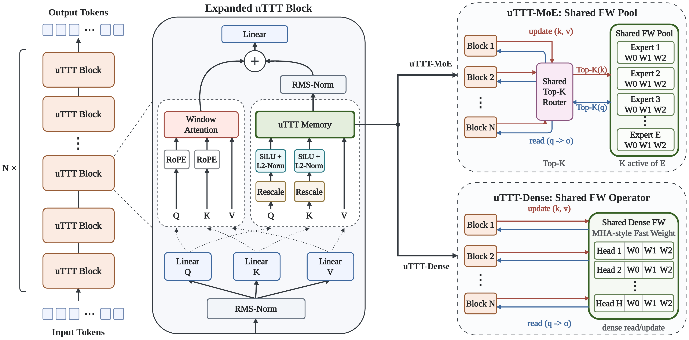

# uTTT — Universal Test-Time Training

**[Project page](https://zefan-cai.github.io/uTTT.github.io/)** ·
**[Paper (arXiv:2610.05484)](https://arxiv.org/abs/2610.05484)** ·
[Documentation](docs/README.md) · [中文指南](docs/README.zh-CN.md) ·
[Configuration catalog](docs/configuration-catalog.md)

<p align="center">
  
</p>

Test-Time Training compresses context into fast weights, and existing designs
make those fast weights **layer-private**: every layer owns a state no other
layer touches. This repository studies the alternative — **universal fast
weights**, where the whole depth stack shares one state or one pool of states —
instantiated as **uTTT-Dense** (a single shared dense operator) and
**uTTT-MoE** (a globally shared expert pool), with **TTT-MoE** (a routed pool
that stays layer-local) as the controlled midpoint. Both task domains are
covered: LVSM-style novel view synthesis and 32K-context language modeling.

## The ownership ladder

| Regime | Who owns the fast weights | Models |
|---|---|---|
| Layer-private | each layer, exclusively | LaCT, TTT-Dense |
| Layer-local pool | each layer routes within its own pool | TTT-MoE |
| Universal (shared) | the whole stack | **uTTT-Dense**, **uTTT-MoE** |

The two domains implement the ladder in opposite ways, and each half's README
explains its own: in `uttt_nvs/` the ladder is a configuration switch on a
single implementation, while `uttt_llm/` ships one model package per paper row,
exactly as the experiments ran.

## Repository structure

```
uTTT/
├── uttt_nvs/    novel view synthesis: training + PSNR/SSIM/LPIPS evaluation
│                Objaverse/GSO and DL3DV configs, including scale ladders
├── uttt_llm/    language modeling at 32K: training + PTL/RULER evaluation
│                124M and 760M configs, global batch 32
├── tools/       CPU-only config and local-manifest validation
├── tests/       CPU regression tests for launchers, checkpoints and data
├── scripts/     shared launcher validation
└── docs/        project page, architecture and reproducibility guides
```

Coverage of the two uTTT variants:

| | Novel view synthesis | Language modeling |
|---|---|---|
| **uTTT-Dense** | released (r1/r2/r4/r8) | released (124M, r1/r2/r4/r6) |
| **uTTT-MoE** | released | released (124M, 760M) |

Each domain also ships its baselines and the TTT-MoE midpoint: full-attention
Transformer, Transformer-SWA, DeltaNet-SWA, Gated DeltaNet-SWA, KDA-SWA,
Mamba-2-SWA, MoM-SWA and LaCT for language modeling; Transformer, DeltaNet and
Gated DeltaNet for novel view synthesis. See the per-domain READMEs for the
full model tables.

## What is not included

This repository ships code and configurations. It does not ship:

- **Trained checkpoints.** The Objaverse novel-view checkpoints are being
  prepared for Hugging Face (see [Checkpoints](#checkpoints)); nothing else is
  released, and every number in the paper comes from a run started from
  scratch. Novel view synthesis configs set
  `max_fwdbwd_passes: 20000` at a global batch of 128, and the trainer rounds
  that budget up to whole epochs, so the published runs stopped at 24,476
  steps on Objaverse/GSO (one epoch = 6,119 passes) and 20,046 on DL3DV (one
  epoch = 3,341 passes); language modeling runs 10,240 (124M) and 40,960
  (760M) steps at a global batch of 32. Reproducing a row means paying that
  cost.
- **Datasets or renderings.** Each half's README names the official sources and
  the format its loader expects; nothing is redistributed here.
- **The evaluation registry's contents.** `uttt_nvs/eval/experiments.yaml`
  describes the metric rerun in terms of your own checkpoints, manifests and
  Weights & Biases account, and its placeholders have to be filled in before it
  will run.
- **Throughput and efficiency benchmarks.** The paper's measured-cost section
  (training throughput, step-time breakdown, GPU-hours to a target loss,
  kernel ablations, inference latency and peak memory) was produced with
  benchmark scripts that are not part of this release.
- **Mechanism experiments.** The Cut backward mode ships as a model option
  (`memory_update_backward_mode = "cross_layer_cut"` in the LLM `uttt_moe`
  package), but the Cut-training analysis, the write-freezing and own-write
  knockouts, the single-route knockouts in NVS, the Jacobian read-output
  probes and the reuse statistics are not included.
- **The length-extrapolation study** (evaluation at 64K, 128K and 256K
  tokens beyond the 32K training context).
- **Large-scale NVS checkpoints.** `uttt_nvs/configs/scale/obj/*` are the
  paper's 242M uTTT-MoE configurations (three-stage Objaverse resolution
  ladder); the paper's runs of that ladder did not finish, no checkpoints or
  reference numbers exist for it, and the DL3DV ladder is not released.

## Install and verify

**No GPU yet? Start with the static checks.** They require only PyYAML (and
`tomli` on Python 3.10), not torch, flash-attn, Triton or a dataset:

```bash
python -m pip install pyyaml 'tomli; python_version < "3.11"'
python -m tools.check_configs --check-catalog
bash uttt_nvs/train/launch.sh --dry-run \
    uttt_nvs/configs/ownership/obj/uttt_moe_e64a1.yaml
```

The checker covers every NVS YAML, LLM architecture JSON and LLM job TOML
under the two `configs/` trees. See [getting started](docs/getting-started.md) for the CPU test environment,
toy-data validation and a bounded first run. Static validation is not GPU
execution or evidence that a published result was reproduced.

The two halves have separate `requirements.txt` and share one reference
environment: Python 3.10 · CUDA 12.8 · torch 2.8.0+cu128.

```bash
# novel view synthesis
pip install torch==2.8.0 torchvision==0.23.0 --index-url https://download.pytorch.org/whl/cu128
pip install -r uttt_nvs/requirements.txt && pip install flash-attn --no-build-isolation
python -m uttt_nvs.tests.smoke_configs --construct --strict
# the three configs/scale/ files also need the VGG-19 .mat (uttt_nvs/README.md, "Larger
# models"); until it is present they are reported as skipped assets, not failures

# language modeling
pip install torch==2.8.0 --index-url https://download.pytorch.org/whl/cu128
pip install -r uttt_llm/requirements.txt && pip install flash-attn --no-build-isolation
(cd uttt_llm && python -m tests.smoke_configs --construct)
```

The last command of each block builds every shipped model on CPU without
touching data. It is the quickest way to catch a flash-attn wheel built against
the wrong torch, which is the usual first failure. It does not exercise
torchtitan, torchdata, `lm_eval`, `matplotlib` or W&B, so problems in the
training or evaluation stack surface only when a launcher or evaluator starts;
follow it with a `--dry-run` and a bounded first run.

## Your first run

Both commands below train **uTTT-MoE**, the paper's globally shared pool. Stop
them whenever you like: they checkpoint as they go.

**Novel view synthesis**, four GPUs, no data required to start:

```bash
python -m uttt_nvs.data.make_toy_dataset --out /tmp/uttt_toy   # 16 scenes, 24 views each
python -m tools.check_manifest /tmp/uttt_toy/manifest.txt --check-images
# copy the template once, then paste the two paths it prints into it
cp -n uttt_nvs/datasets.example.yaml uttt_nvs/datasets.yaml
NPROC_PER_NODE=4 bash uttt_nvs/train/launch.sh \
    uttt_nvs/configs/ownership/obj/uttt_moe_e64a1.yaml -s exp_name first_run
```

The run writes to `experiments/first_run/`. The synthetic scenes carry no real
3D structure — they exist so the loader, model, optimizer and checkpointing can
be exercised before Objaverse or DL3DV are in place. Swap
`uttt_nvs/datasets.yaml` for real manifests when you have them; see
[`uttt_nvs/data/README.md`](uttt_nvs/data/README.md).

**Language modeling**, 124M at 32K context:

```bash
cd uttt_llm
huggingface-cli login                   # the dataset is gated on the HF hub
python -m flame.utils.preprocess \
    --dataset togethercomputer/Long-Data-Collections \
    --data_dir pretrain \
    --path /path/to/arrow-shards          # any HF text dataset works for a trial
# point uttt_llm/datasets.yaml at those shards
NPROC_PER_NODE=8 bash launch/train.sh \
    configs/exp/train_124M_32k.toml configs/main/124M/uttt_moe.json first_run
cd ..
```

On fewer than eight GPUs, add `--training.gradient_accumulation_steps` to keep
the global batch at 32; the trainer refuses to start otherwise.

## Then pick a domain

| | Data, training and evaluation |
|---|---|
| Novel view synthesis | [`uttt_nvs/README.md`](uttt_nvs/README.md) — manifests, the config tree, PSNR/SSIM/LPIPS with bootstrap intervals |
| Language modeling | [`uttt_llm/README.md`](uttt_llm/README.md) — arrow shards, the config tree, per-token loss and RULER |

## Checkpoints

The Objaverse/GSO novel-view checkpoints behind the paper's tables will be
published on Hugging Face in the layout the evaluation registry expects
(`object/<model>/checkpoint.pt`); this README will link them when they are up.
DL3DV and language-modeling checkpoints are not released.

## Project page

[zefan-cai.github.io/uTTT.github.io](https://zefan-cai.github.io/uTTT.github.io/)
hosts the overview, result figures and the novel-view demo renderings.

## Acknowledgements

See the [detailed documentation](docs/README.md) for architecture, configuration
semantics, data contracts, training/resume, evaluation and troubleshooting.


This code builds on [LaCT](https://tianyuanzhang.com/projects/ttt-done-right/),
[flame](https://github.com/fla-org/flame) and
[flash-linear-attention](https://github.com/fla-org/flash-linear-attention)
from fla-org, and [torchtitan](https://github.com/pytorch/torchtitan).

## Citation

Paper: [arXiv:2610.05484](https://arxiv.org/abs/2610.05484).

```bibtex
@article{cai2026universal,
  title   = {Universal Test-Time Training},
  author  = {Cai, Zefan and Hu, Qinzhe and Ma, Ziqiao and Tan, Hao and Hu, Junjie},
  journal = {arXiv preprint arXiv:2610.05484},
  year    = {2026}
}
```

## License

MIT. See [LICENSE](LICENSE). Vendored and derived third-party code (LaCT,
flame, flash-linear-attention, torchtitan, Mamba-2 kernels, TransformerEngine
permutation kernels) keeps its own license; see
[THIRD_PARTY_NOTICES.md](THIRD_PARTY_NOTICES.md).
